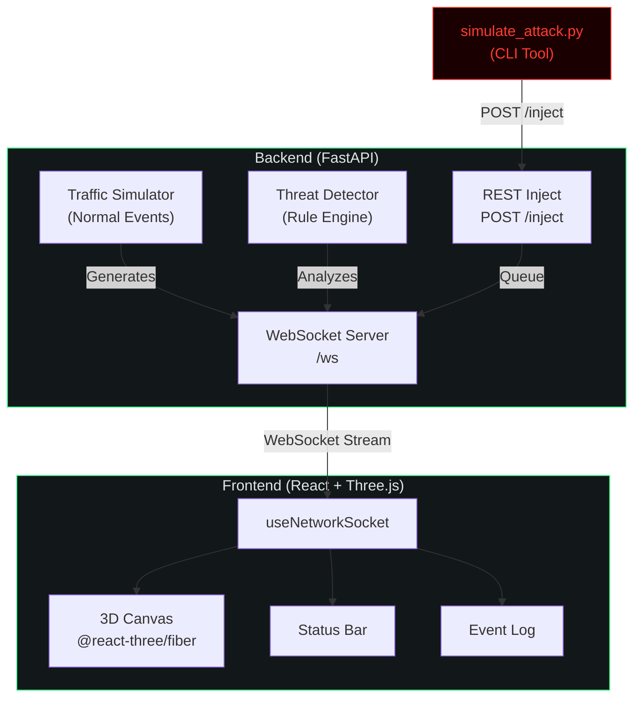

<p align="center">
  
</p>

<h1 align="center">WebSentinel</h1>

<p align="center">
  <strong>Real-time network threat visualization</strong><br/>
  A live animated 3D dashboard that captures network traffic, detects suspicious patterns,<br/>
  and renders them as an interactive node graph with real-time threat alerts.
</p>

<p align="center">
  
  
  
  
</p>

---

## What is WebSentinel?

WebSentinel is an open-source network security visualization tool that:

- **Visualizes** your network as a live 3D node graph — each device is a floating node, each connection an animated beam of light
- **Detects** threats in real-time using a simple, explainable rule-based engine (port scans, brute-force login attempts, anomalous data transfers)
- **Alerts** with dramatic visual feedback — attacking nodes flare red with expanding shockwave rings, connection lines turn red, and the event log fills with color-coded threat entries

Built for hackathon demos and security training — fully self-contained with simulated traffic, no real packet capture needed to run.

---

## Architecture



### Detection Rules

| Threat Type | Rule | Threshold | Window |
|---|---|---|---|
| **Port Scan** | Connections to N distinct ports from same source | ≥10 ports | 5 seconds |
| **Brute Force** | Failed auth attempts from same source | ≥5 attempts | 10 seconds |
| **Data Exfiltration** | Single outbound transfer exceeding threshold | ≥50 MB | Instant |

All rules are explainable — no black-box ML. Judges can understand the detection logic in seconds.

---

## Quick Start

### Option 1: Docker (Recommended)

```bash
git clone https://github.com/yourusername/websentinel.git
cd websentinel
docker-compose up --build
```

Open [http://localhost:5173](http://localhost:5173) in your browser.

### Option 2: Manual Setup

**Backend:**
```bash
cd backend
python -m venv venv
source venv/bin/activate    # Windows: venv\Scripts\activate
pip install -r requirements.txt
uvicorn app.main:app --host 0.0.0.0 --port 8000
```

**Frontend (new terminal):**
```bash
cd frontend
npm install
npm run dev
```

Open [http://localhost:5173](http://localhost:5173).

---

## How to Demo This

This is the demo flow for a live presentation:

### 1. Start the Stack
```bash
# Terminal 1 — Backend
cd backend
uvicorn app.main:app --port 8000

# Terminal 2 — Frontend
cd frontend
npm run dev
```

### 2. Show the Calm State
Open the dashboard. You'll see:
- 12 network nodes floating in 3D space with gentle idle motion
- Green connection lines with animated data packets traveling between nodes
- A quiet event log streaming normal heartbeats, connections, and data transfers
- Status bar showing `NODES: 12 | THREATS: 0`

Let this run for 10–15 seconds. This is the "everything is normal" baseline.

### 3. Launch the Attack
In a third terminal:

```bash
cd backend
python simulate_attack.py                     # Port scan (default)
python simulate_attack.py --type brute_force  # Brute force variant
python simulate_attack.py --type both         # Both sequentially
```

### 4. Watch the Dashboard React
Within 1–2 seconds:
- ⚡ A new node appears on the edge of the graph — the attacker (`10.0.0.66`)
- 🔴 The attacker node flares red with a shockwave ring expanding outward
- 📡 The connection line to the target (`web-srv-01`) turns red and thickens
- 📋 3–4 red log entries stream into the event panel in quick succession
- 📊 The threat counter in the status bar increments


---

## Email Alerts

WebSentinel can send an email to the owner whenever the detector raises a **Port Scan** or **Brute Force** alert. Data Exfil events do **not** trigger emails. Each alert event produces exactly one email; multiple alerts are never merged.

### Setup

1. **Enable Gmail 2-Step Verification** and generate an [App Password](https://myaccount.google.com/apppasswords) (16 letters, no spaces).

2. Copy the example env file and fill in your values:

   ```bash
   cp backend/.env.example backend/.env
   # then edit backend/.env — it is git-ignored
   ```

3. The three required keys are:

   ```
   ALERT_EMAIL_FROM=you@gmail.com
   ALERT_EMAIL_PASSWORD=xxxx xxxx xxxx xxxx   # your 16-letter App Password
   ALERT_EMAIL_TO=owner@example.com
   ```

4. **Test without a real SMTP server** — start a local debug server and run the test script:

   ```bash
   # terminal 1 — debug SMTP server (install aiosmtpd once: pip install aiosmtpd)
   python -m aiosmtpd -n -l localhost:1025

   # terminal 2 — send two sample emails
   cd backend
   ALERT_SMTP_HOST=localhost ALERT_SMTP_PORT=1025 ALERT_SMTP_SSL=false \
       python send_test_email.py
   ```

### How it works

- Settings are loaded from `backend/.env` at startup. A real environment variable (e.g. set on Render) always wins over the file.
- If any required key is missing the feature is disabled at startup and a single log line is printed; the rest of the app is unaffected.
- The SMTP call runs in a background thread with a 10-second timeout so the WebSocket and event queue are never slowed.
- At most `ALERT_MAX_PER_MINUTE` (default 10) emails are sent per rolling 60-second window; extras are skipped and logged.
- The password is **never** logged, printed, or included in any error message.

### Security checklist

| Rule | Status |
|---|---|
| `backend/.env` is in `.gitignore` | ✅ |
| `backend/.env` is in `backend/.dockerignore` | ✅ |
| `.env.example` contains only placeholders | ✅ |
| Password stripped from all log messages | ✅ |
| `override=False` so real env vars win | ✅ |

---

## Tech Stack

| Layer | Technology |
|---|---|
| **3D Visualization** | React, Three.js, @react-three/fiber, @react-three/drei |
| **UI Chrome** | Tailwind CSS v4, custom CSS design system |
| **Realtime** | Native WebSocket |
| **Backend** | Python 3.11+, FastAPI, Uvicorn |
| **Packet Capture** | Scapy (optional, for real traffic mode) |
| **Packaging** | Docker, docker-compose |

---

## Project Structure


websentinel/
├── backend/
│   ├── app/
│   │   ├── __init__.py
│   │   ├── main.py          # FastAPI server + WebSocket endpoint
│   │   ├── detector.py      # Rule-based threat detection engine
│   │   └── simulator.py     # Normal traffic generator + device pool
│   ├── simulate_attack.py   # CLI attack injection tool
│   ├── requirements.txt
│   └── Dockerfile
├── frontend/
│   ├── src/
│   │   ├── scene/           # 3D components (NetworkGraph, Node, etc.)
│   │   ├── components/      # UI (StatusBar, EventLog, ScanlineOverlay)
│   │   ├── hooks/           # State management (useNetworkSocket, useUptime)
│   │   ├── App.jsx          # Root layout
│   │   ├── main.jsx         # Entry point
│   │   └── index.css        # Design system + global styles
│   ├── index.html
│   ├── vite.config.js
│   ├── package.json
│   └── Dockerfile
├── demo-website/            # Student Portal demo site + attack script
│   ├── app.py               # FastAPI Student Portal
│   ├── websentinel_middleware.py  # Telemetry middleware
│   ├── attack_demo.py       # Demo attack script (brute/scan/exfil)
│   ├── requirements.txt
│   └── README.md
├── docker-compose.yml
├── README.md
└── .gitignore


---

## Live Demo with the Student Portal

Run the full end-to-end demo to show real traffic flowing into WebSentinel from a live site:

```bash
# Terminal 1 — WebSentinel backend
cd backend && uvicorn app.main:app --port 8000

# Terminal 2 — Student Portal demo site
cd demo-website && pip install -r requirements.txt
WEBSENTINEL_URL=http://localhost:8000 uvicorn app:app --port 8080

# Terminal 3 — run the demo attack sequence
cd demo-website && python attack_demo.py --type all --host http://localhost:8080
```

Open the dashboard at [http://localhost:5173](http://localhost:5173) and watch brute force, web scan, and data exfil alerts appear in real time as the attack script runs.


